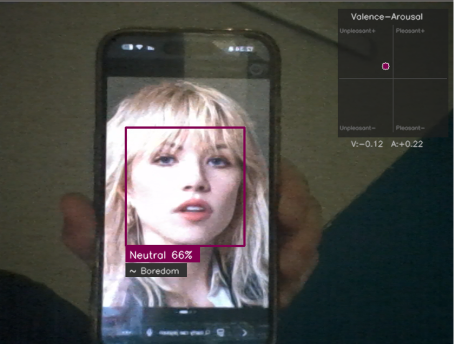

# Real-Time Facial Affect Analysis

Detects human faces in a live webcam feed and performs two types of affect analysis in parallel:

- **Categorical:** Classifies expressions into 7 discrete emotions
- **Dimensional:** Predicts continuous Valence (positive/negative) and Arousal (calm/excited) values
- **Fusion:** Cross-validates both outputs using Russell's Circumplex and Plutchik's Wheel of Emotions to infer intensity levels, compound emotions (dyads), and reliability.



## Why This Exists

The human face is a remarkably dense signal: a single expression can carry dozens of co-occurring micro-expressions, our expressive repertoire has expanded dramatically over evolutionary time, and yet individuals and cultures still differ widely in how they portray the same underlying states. Standard categorical recognition, seven labels and an argmax, captures almost none of that structure.

This project instead grounds its analysis in a small stack of classic affect frameworks:

- **Russell's Circumplex Model (1980)**: affect represented as geometry in the valence-arousal plane rather than as a list of categories. This forms the basis of the dimensional analysis.
- **Ekman's six basic emotions**: the classic categorical vocabulary, which turns out to be too coarse for this project's goals, motivating a richer model.
- **Plutchik's Wheel of Emotions (1980)**: eight basic emotions arranged as petals on an intensity scale, combined through dyads into sixteen distinct emotion labels.
- **Mehrabian's PAD model (1974/1995)**: empirically measured Pleasure-Arousal-Dominance word coordinates, the key piece that provides a numeric bridge from continuous geometry back onto discrete Plutchik labels. Implemented here as the `AffectFusionEngine`.

The remaining components are standard computer vision: MediaPipe BlazeFace, Mini Xception, MobileNetV2 (regression). Together they yield a psychologically grounded, current analysis of the emotions displayed by the human face.

Full academic write-up (IEEE format, theory lineage, and equations): [ieee_project_report.md](ieee_project_report.md)

## Tech Stack

| Component                  | Tool                                            |
| -------------------------- | ----------------------------------------------- |
| Face Detection             | MediaPipe BlazeFace (short-range)               |
| Emotion Classification     | Mini Xception (trained on FER-2013)             |
| Valence-Arousal Regression | MobileNetV2 (trained on AffectNet)              |
| Affect Fusion              | AffectFusionEngine (Russell + Plutchik)         |
| Inference Runtime          | TensorFlow Lite                                 |
| Parallel Execution         | Python`concurrent.futures.ThreadPoolExecutor` |
| Image Processing           | OpenCV                                          |

## Project Structure

```
emot_recog/
├── facecombined.py              # Combined emotion + VA + fusion (parallel inference)
├── affect_fusion.py             # AffectFusionEngine (Plutchik/Russell integration)
├── facemot.py                   # Emotion classification
├── faceva.py                    # Standalone valence-arousal regression
├── convert_to_tflite.py         # HDF5 → TFLite (emotion model)
├── convert_va_to_tflite.py      # H5 weights → TFLite (VA model)
└── models/
    ├── emotionModel.tflite      # Emotion classifier (236 KB)
    ├── vaModel.tflite           # VA regressor (13.8 MB)
    ├── blaze_face_short_range.tflite  # MediaPipe face detection (225 KB)
    ├── emotionModel.hdf5        # Original emotion weights
    └── regressor_weights.h5     # Original VA weights
```

## How It Works

1. Captures frames from webcam via OpenCV (mirrored for selfie view)
2. MediaPipe BlazeFace detects faces → extracts face ROI per detection
3. Two models run **in parallel** per face via thread pool:
   - **Emotion:** Grayscale ROI → 64x64 → normalize to [-1, 1] → Mini Xception → 7-class softmax
   - **VA:** Color ROI → 224x224 RGB → normalize to [-1, 1] → MobileNetV2 → [valence, arousal]
4. **AffectFusionEngine** processes both outputs:
   - EMA-smooths V/A to reduce jitter
   - Russell sanity check (conflict score between categorical prediction and VA position)
   - Nearest-centroid mapping to Plutchik's 8 primary petals (using Mehrabian PAD coordinates)
   - Categorical disambiguation for ambiguous VA regions (e.g., Fear vs Anger)
   - Intensity inference (mild/basic/intense) from VA magnitude
   - Dyad detection from softmax distribution (e.g., Fear + Surprise → Awe)
5. Overlays: base emotion + confidence, Plutchik intensity word, dyad label, VA HUD grid

## Setup

```bash
python -m pip install -r reqs.txt
```

## Usage

**Combined with fusion (recommended):**

```bash
cd emot_recog
python facecombined.py
```

**Emotion only:**

```bash
python facemot.py
```

**Valence-Arousal only:**

```bash
python faceva.py
```

All scripts support `-vw True` to save output to video. Press `Esc` to exit

## Evaluation

Scripts live in `eval/` and run from the repo root. Datasets, caches, the EmoNet checkout, and its environment are gitignored.

**Latency benchmark** (no data needed):

```bash
python -m eval.benchmark_latency
```

Result on an Intel Core i5-1035G7 (CPU only, one face): median 20.5 ms per frame, about 49 FPS before capture and rendering. See `eval/results/latency.json`.

**Fusion evaluation on FER-2013** (conflict-score AUROC, FER+ ambiguity agreement, threshold ablations):

1. Download the FER-2013 challenge CSV (`fer2013.csv`) from Kaggle into `data/fer2013/`.
2. Download the FER+ labels (`fer2013new.csv`, from the microsoft/FERPlus repo) into `data/ferplus/`.
3. Run:

```bash
python -m eval.evaluate_fer --fer data/fer2013/fer2013.csv
```

**EmoNet baseline** (optional, unmodified, CC BY-NC-ND 4.0): clone `face-analysis/emonet` into `third_party/emonet`, create a separate PyTorch environment `emonet_env`, then run this before `evaluate_fer`:

```bash
emonet_env/Scripts/python -m eval.emonet_baseline --fer data/fer2013/fer2013.csv
```

`python -m eval.smoke_test_evaluate` checks the evaluation pipeline on synthetic data.

## Models

|                        | Emotion                  | Valence-Arousal                      |
| ---------------------- | ------------------------ | ------------------------------------ |
| **Architecture** | Mini Xception            | MobileNetV2 + Dense(1024) + Dense(2) |
| **Dataset**      | FER-2013 (35,887 images) | AffectNet (400K+ images)             |
| **Input**        | 64x64 grayscale          | 224x224 RGB                          |
| **Output**       | 7-class softmax          | 2 floats: valence, arousal           |
| **Params**       | 58K                      | 3.6M                                 |
| **TFLite size**  | 236 KB                   | 13.8 MB                              |

### Emotion Classes

`Angry` · `Disgust` · `Fear` · `Happy` · `Sad` · `Surprise` · `Neutral`

### Valence-Arousal Scale

- **Valence** [-1, 1]: Negative ← 0 → Positive
- **Arousal** [-1, 1]: Calm ← 0 → Excited

## Affect Fusion

The `AffectFusionEngine` integrates three psychological frameworks:

**Russell's Circumplex Model** — validates that the categorical prediction (e.g., "Happy") is consistent with the VA coordinates. A conflict score flags unreliable predictions.

**Plutchik's Wheel of Emotions** — maps VA coordinates to 8 primary emotion petals by nearest centroid, using published PAD word ratings (Russell & Mehrabian, 1977) where a source exists. Trust is unsourced, and the Surprise valence differs from its source; see the report for provenance. Each petal has 3 intensity levels:

| Petal        | Mild         | Basic        | Intense    |
| ------------ | ------------ | ------------ | ---------- |
| Joy          | Serenity     | Joy          | Ecstasy    |
| Trust        | Acceptance   | Trust        | Admiration |
| Fear         | Apprehension | Fear         | Terror     |
| Surprise     | Distraction  | Surprise     | Amazement  |
| Sadness      | Pensiveness  | Sadness      | Grief      |
| Disgust      | Boredom      | Disgust      | Loathing   |
| Anger        | Annoyance    | Anger        | Rage       |
| Anticipation | Interest | Anticipation | Vigilance |

**Mehrabian's PAD model (1974/1995)** — supplies the empirically measured Pleasure-Arousal-Dominance word coordinates that bridge continuous VA geometry onto discrete Plutchik petals (P ≈ valence, A ≈ arousal). The Dominance axis, the true fear/anger discriminator, is truncated in this 2-D pipeline; the engine compensates with categorical disambiguation when the two nearest petal centroids tie.

**Dyads** (compound emotions) are inferred when the classifier's top two predictions are close in confidence. The engine implements all 8 primary and 8 secondary dyads, but only the 9 that avoid Trust and Anticipation can fire, since FER-2013 has no class for either:

| Primary Dyad | Components         |
| ------------ | ------------------ |
| Love         | Joy + Trust        |
| Awe          | Fear + Surprise    |
| Contempt     | Disgust + Anger    |
| Optimism     | Anticipation + Joy |
| Remorse      | Sadness + Disgust  |
